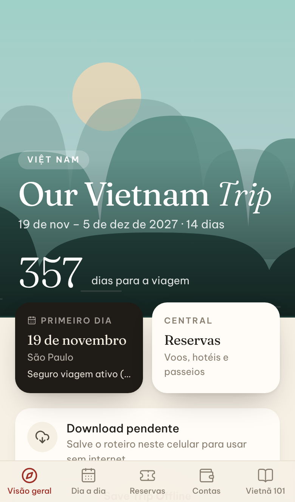
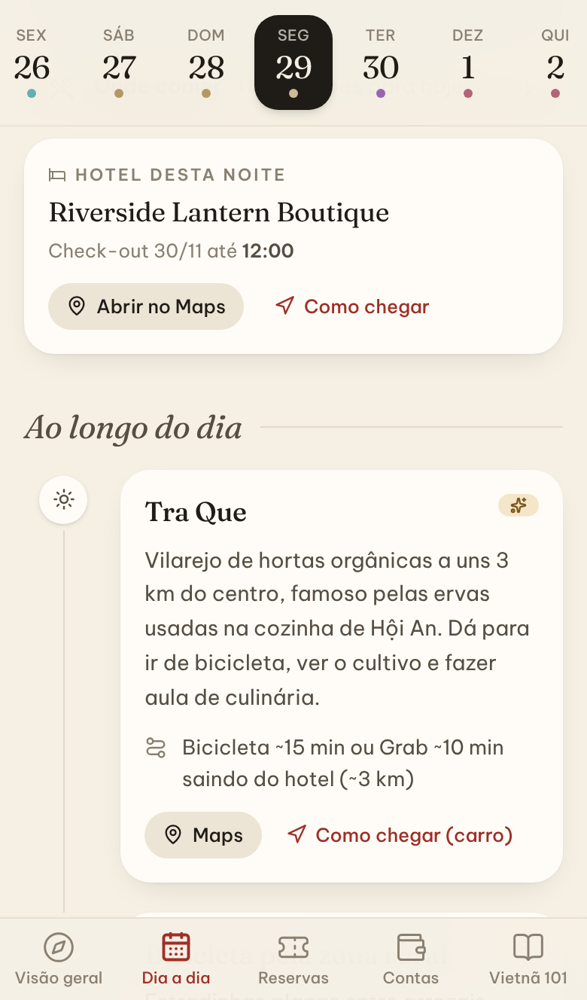
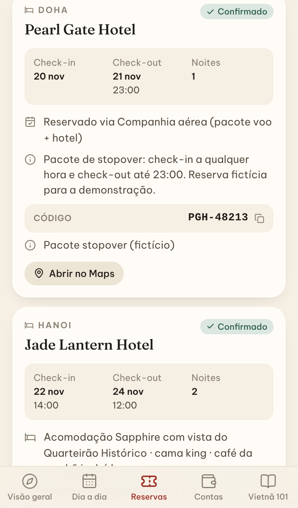
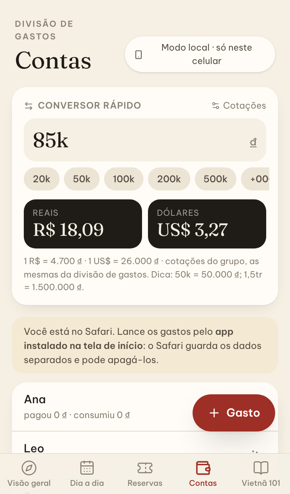
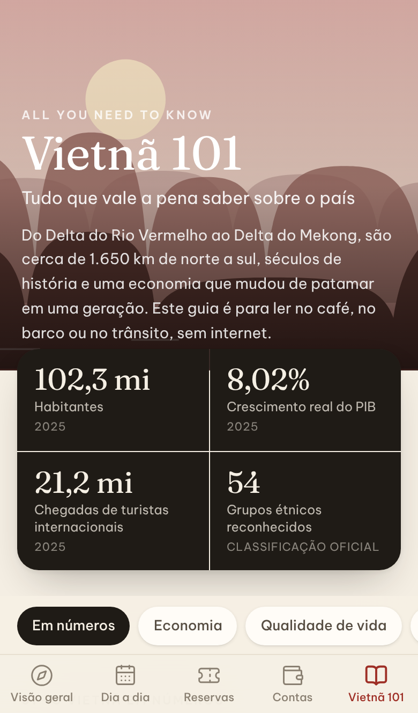

# Trip Companion

An offline-first travel companion PWA for a small group trip — itinerary, logistics, booking codes, travel documents, shared expenses and a cultural mini-guide — built with **vibe coding** (an AI pair programmer) for a real trip to Vietnam, and published here as a reusable template **with fictional data**.

> **Personal project, built with AI. No professional security audit.** Read [Security & known limitations](#security--known-limitations) before using it with real data.

<p>
  
  
  
  
  
</p>

The UI is in Brazilian Portuguese. Everything in this repository — travellers (Ana, Leo and Sam), hotels, flights, booking codes, documents and expenses — is **fictional**. Attractions, restaurants and the cultural guide are public places and information.

## Features

- **Day by day** — schedule per day with descriptions, opening-time tips, rain warnings and plan B, ~10 restaurant suggestions per day, and *how to get there* from the previous stop (on foot vs. ride-hailing) with Google Maps links in the right travel mode.
- **Logistics** — flights, hotels, transfers and tours; what is still pending; per-day "Decisões" (open choices) cards.
- **Groups with separate bookings** — each phone picks a group (e.g. a couple and a friend). Each group sees its own booking codes, to-dos and notes.
- **Booking codes** — encrypted with a trip passphrase at build time; decrypted on the phone. Travellers can add their own codes from the app.
- **Travel documents** — visas, insurance, vaccine certificates and tickets, encrypted on the phone (AES-256-GCM) and readable offline with an in-app PDF viewer (pdf.js).
- **Shared expenses** — Splitwise-style split with balances, fewest transfers to settle up, other currencies with a saved rate, and a fast currency converter (₫ → R$ / US$).
- **Vietnã 101** — editorial mini-guide: numbers with sources and reference years, economy (GDP composition chart), history timeline, beliefs, street life, coffee, food by region, North/Centre/South comparison, cities, etiquette, survival phrases.
- **Offline-first PWA** — installable; a service worker precaches the whole app; "Save Trip Offline" verifies the offline copy.
- **Silly bits** — an 8-bit dancing camel on arrival in Doha and an overloaded scooter honking "Welcome to Vietnam" on day 1 (try `?camelo` and `?vietnam`).

## Try the demo

```bash
npm install
npm run build && npm run preview     # http://localhost:4173
```

Pick **Ana e Leo** or **Sam**. To see booking codes and documents, unlock with the demo passphrase **`lanterna arroz bicicleta 27`** (spaces and case are ignored). Without a backend configured, expenses and documents run in **local mode** (only on that phone).

## Tech stack

React 18 · TypeScript · Vite 7 · Tailwind CSS 4 · vite-plugin-pwa (custom service worker, Workbox) · pdf.js · Web Crypto API · Vitest · Playwright · optional Supabase (Postgres + RPC functions) · deploys as a static site (Vercel config included).

## Architecture

```
src/
  data/trip.ts         the trip: cities, places, hotels, flights, bookings, days, travellers, groups
  data/food.ts         restaurant suggestions per day
  data/guide.ts        "Vietnã 101" content (typed, with sources)
  data/private.enc.json  booking codes + keys, encrypted with the trip passphrase (PBKDF2 → AES-GCM)
  data/validate.ts     validation run before every build (references, dates, time zones, cities)
  pages/ components/   UI (mobile-first)
  expenses/            split logic + optional sync (offline queue, newest edit wins)
  docs/                document encryption, optional sync, in-app PDF viewer
  lib/backend.ts       optional Supabase configuration (local mode when absent)
  sw.ts                service worker (precache + offline verification)
public/seed-docs/      documents shipped with the app, encrypted per group
supabase/              SQL for the optional sync backend (tables + RPC functions)
scripts/               data validation, encryption helpers, offline e2e, demo video recorder
```

- **No server is required.** The app is static. Private data ships encrypted inside the bundle; documents in `public/seed-docs` are encrypted per group.
- **Optional sync.** With Supabase configured, expenses, documents added on a phone and typed booking codes sync between phones. Rows live behind `SECURITY DEFINER` RPC functions; tables have RLS on and no direct grants. Expenses are keyed by a random trip key; documents and codes are **encrypted on the phone** and the server only sees ciphertext and a hash of the key.

## Customize for your trip

1. **Itinerary** — edit `src/data/trip.ts`: travellers (`trip.travelers`), groups (`trip.parties` with `members`), cities, places, hotels, flights, bookings and days. `npm run validate` checks it.
2. **Restaurants and guide** — `src/data/food.ts` and `src/data/guide.ts` (or remove the guide route in `src/App.tsx`).
3. **Private data** — copy `private.example.json` to `private/private.json` (git-ignored) and fill in your codes. Then:
   ```bash
   node scripts/new-keys.mjs couple sam        # your group ids
   node scripts/add-seed-doc.mjs --party couple --owner ana --title "E-visa" ~/evisa.pdf
   TRIP_PASSPHRASE="a long passphrase of four or five words" npm run private:encrypt
   ```
   Replace the demo files: delete `public/seed-docs/*` and `demo/` before adding yours. **Never reuse the demo keys.**
4. **Welcome screens** — the camel shows on the first day in Doha, the scooter on `trip.dayOneDate`. Adapt or remove them in `src/components/`.
5. **Currencies** — the expense currencies and default rates are in `src/expenses/logic.ts`.

## Optional: sync between phones (Supabase)

1. Create a Supabase project and run `supabase/vt_expenses.sql` and `supabase/vt_documents.sql` in the SQL editor.
2. Copy `.env.example` to `.env` and set `VITE_SUPABASE_URL` and `VITE_SUPABASE_ANON_KEY` (the public anon/publishable key — never the service-role key).
3. Rebuild. The CSP in `vercel.json` allows `https://*.supabase.co`; narrow it to your project URL.

## Deploy

Any static host works. For Vercel: import the repo (framework: Vite, output `dist`); `vercel.json` sets security headers (CSP, HSTS, frame-ancestors, no-referrer, noindex) and SPA rewrites. Set the two `VITE_SUPABASE_*` variables in the project only if you use sync.

## Tests

```bash
npm test                     # unit tests (data, crypto, expenses, documents, guide)
npm run build                # validate data + typecheck + build
node scripts/e2e-offline.mjs # Playwright: install the PWA, go offline, navigate
npm run demo:record && npm run demo:compose   # re-record the demo video (needs ffmpeg + Pillow)
```

## Security & known limitations

This is a personal project built with an AI assistant. It has automated tests and a self-review, **not a professional security audit**. Known limitations:

- **The passphrase is the security boundary.** Anyone with the app URL can download the encrypted bundle and try to guess the passphrase offline (PBKDF2-SHA256, 310k iterations). Use a long passphrase (4–5 random words) and keep the URL private.
- **The passphrase is stored on each device** (localStorage) so the app opens offline. A lost, unlocked phone exposes the codes and documents.
- **Shared secrets, no accounts.** Everyone in the trip shares the same passphrase; there is no per-user authentication, no revocation and no audit log. Changing the passphrase means re-encrypting and redeploying; rotate the expenses/documents keys as well.
- **Expenses are not end-to-end encrypted.** With sync on, expense rows are stored in plain JSON, keyed by a random trip key. Anyone with that key (it ships inside the encrypted bundle) can read and write them.
- **Sync is last-write-wins**, without conflict resolution or history; deletions are soft deletes.
- **Server abuse limits are basic** (row/size caps in the SQL functions); there is no rate limiting beyond what Supabase provides.
- **Data accuracy.** Opening hours, prices, entry rules and statistics change. The guide shows reference years and sources; nothing updates automatically.
- **Dev-only dependency advisories.** `npm audit --omit=dev` reports 0 issues; `npm audit` reports moderate advisories in the build chain of `vite-plugin-pwa` (workbox-build → glob/minimatch). They run only at build time and are not shipped to the site.
- **iOS Safari** keeps the home-screen app storage separate from Safari tabs and may evict data from websites that aren't installed.

## License

MIT — see [LICENSE](LICENSE). Recommended because it is short, permissive and common for small reusable templates. Third-party data (restaurants, guide facts) is public information with sources cited in the app.
